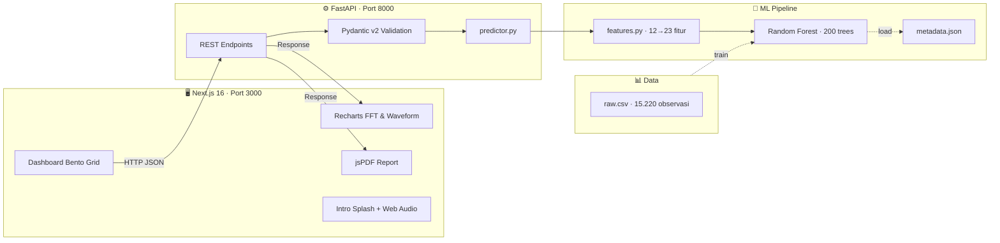

<p align="center">
  
</p>

<h1 align="center">VibraCheck</h1>
<p align="center"><b>Industrial Bearing Diagnostic Hub</b></p>

<p align="center">
  
  
  
  
  
  
  
  
  
</p>

<p align="center">
  Sistem diagnosis kerusakan bantalan mesin pabrik semen berbasis analisis getaran akselerometer & <i>Random Forest</i> multikelas — dikemas dalam arsitektur decoupled <b>FastAPI + Next.js</b> berstandar industri.
</p>

---

## Daftar Isi

- [Fitur Utama](#-fitur-utama)
- [Tech Stack](#-tech-stack)
- [Quick Start](#-quick-start)
- [Arsitektur](#-arsitektur)
- [Performa Model](#-performa-model)
- [REST API](#-rest-api)
- [Struktur Proyek](#-struktur-proyek)
- [npm Scripts](#-npm-scripts)
- [Testing](#-testing)
- [Deployment](#-deployment)
- [Sistem Desain](#-sistem-desain)
- [Kredit](#-kredit)

---

## ✦ Fitur Utama

### 🖥️ Dashboard Industri

| Fitur | Deskripsi |
|---|---|
| **Diagnosa Real-time** | Klasifikasi 4 kondisi bantalan dengan probabilitas per kelas dan status bahaya semantik (AMAN / WASPADA / KRITIS) |
| **Spektrum FFT** | Grafik frekuensi akselerasi interaktif dengan ambang batas kritis 1.20 g pk dan penanda BPFO / BPFI / BSF |
| **Gelombang Waktu** | Visualisasi sinyal domain waktu dengan metrik Peak-to-Peak dan RMS |
| **Rekomendasi ISO 20816** | Suku cadang, kode part, ketersediaan gudang, dan zonasi getaran ISO otomatis |
| **Quick Presets** | 4 tombol skenario cepat (*Normal*, *Outer Race*, *Inner Race*, *Ball Fault*) langsung inferensi |
| **Unit Mesin Switcher** | Pemilih 4 unit turbine pump dengan status independen |

### 🧪 Fitur Lanjutan

| Fitur | Deskripsi |
|---|---|
| **Batch Analysis** | Upload CSV multi-mesin → tabel armada, filter kategori, download CSV hasil |
| **PDF Report Export** | Unduh laporan diagnosis lengkap dengan header logo, metrik, grafik, dan rekomendasi ISO |
| **Sensor Modal** | Panel input manual 12 parameter sensor dengan demo validasi 422 |
| **Panduan ISO Modal** | Referensi zonasi getaran ISO 20816 interaktif |
| **Intro Splash** | Animasi maskot winking dengan efek suara prosedural (Web Audio API) |
| **Profil Operator** | Switcher identitas analis getaran |

---

## ✦ Tech Stack

### Backend

| Teknologi | Versi | Fungsi |
|---|---|---|
| Python | 3.14 | Runtime |
| FastAPI | 0.162 | REST API framework |
| scikit-learn | 1.6.1 | Pipeline ML (Random Forest) |
| XGBoost | 3.4.1 | Benchmarking model |
| Pandas | 3.1.0 | Preprocessing data |
| Pydantic | 2.14 | Validasi input ketat |
| Streamlit | 1.66 | UI alternatif monolitik |

### Frontend

| Teknologi | Versi | Fungsi |
|---|---|---|
| Next.js | 16.4 | App Router SSR/SSG |
| React | 19.3 | UI framework |
| TypeScript | 5.x | Static typing |
| Tailwind CSS | 4.3 | Styling utility-first |
| Motion | 14.14 | Animasi & transisi |
| Recharts | 3.11 | Grafik interaktif |
| jsPDF | 4.2 | Generasi laporan PDF |
| Lucide React | 1.75 | Ikon industri |

---

## ✦ Quick Start

### 🚀 1-Klik Fullstack

```powershell
# Clone & masuk ke direktori
git clone https://github.com/Boerhan06/mkb-ml-p3.git
cd mkb-ml-p3

# Setup Python environment
python -m venv .venv
.\.venv\Scripts\activate
pip install -r requirements-dev.txt

# Setup Node.js frontend
cd web && npm install && cd ..

# Jalankan semuanya
.\run.bat
```

> [!TIP]
> `run.bat` otomatis menjalankan backend FastAPI (port 8000) dan frontend Next.js (port 3000) secara paralel, termasuk auto-free port jika port sedang terpakai.

**Akses:**
- 🖥️ Dashboard VibraCheck → `http://localhost:3000`
- 📡 Swagger API Docs → `http://localhost:8000/docs`

### Menjalankan Terpisah

```powershell
# Backend saja
npm run api

# Frontend saja
npm run web

# Streamlit (Mode A)
npm run ui
```

---

## ✦ Arsitektur



Aplikasi mendukung **2 mode deployment**:

| | Mode A: Streamlit | Mode B: Next.js (VibraCheck) |
|---|---|---|
| **Arsitektur** | Monolitik Python | Decoupled REST API |
| **Frontend** | Streamlit built-in | Next.js 16 + TypeScript |
| **Visualisasi** | Matplotlib statis | Recharts interaktif |
| **Target** | Prototipe & demo | Produksi industri |
| **Skalabilitas** | Vertikal tunggal | Horizontal independen |

---

## ✦ Performa Model

**Random Forest Classifier** · 200 trees · balanced class weights · max depth 20

### Metrik Evaluasi (Test Set 20% — 3.044 sampel)

| Metrik | Skor |
|---|---|
| **Macro F1-Score** | **0.8014** |
| **Akurasi** | **84.0%** |
| **Baseline (Logistic Regression)** | 0.6909 |
| **Peningkatan F1** | +0.1105 |

### F1-Score per Kelas

| Kelas | Precision | Recall | F1-Score | Support |
|---|---|---|---|---|
| `normal` | 80.3% | 96.1% | **0.8751** | 1.666 |
| `outer_race` | 91.5% | 74.9% | **0.8238** | 618 |
| `inner_race` | 89.2% | 67.0% | **0.7655** | 443 |
| `bola` | 92.5% | 61.8% | **0.7410** | 317 |

### Confusion Matrix

|  | Pred: bola | Pred: inner_race | Pred: normal | Pred: outer_race |
|---|---|---|---|---|
| **Aktual: bola** | **196** | 5 | 110 | 6 |
| **Aktual: inner_race** | 7 | **297** | 136 | 3 |
| **Aktual: normal** | 7 | 24 | **1.601** | 34 |
| **Aktual: outer_race** | 2 | 7 | 146 | **463** |

### Fitur Input (12 parameter sensor)

<details>
<summary>Lihat detail fitur</summary>

**Domain Waktu & Operasional:**
- `posisi_sensor` — drive_end / non_drive_end
- `kecepatan_rpm` — Kecepatan putaran rotor
- `beban_kN` — Beban aksial mesin
- `suhu_housing_C` — Suhu selubung bantalan
- `rms_g` — Root Mean Square akselerasi
- `puncak_g` — Amplitudo puncak getaran
- `kurtosis` — Distribusi ekor impuls
- `crest_factor` — Rasio puncak/RMS

**Domain Frekuensi (FFT):**
- `energi_bpfo` — Energi Ball Pass Frequency Outer
- `energi_bpfi` — Energi Ball Pass Frequency Inner
- `energi_bsf` — Energi Ball Spin Frequency
- `frekuensi_dominan_hz` — Frekuensi puncak spektral

**+11 Fitur Rekayasa** (`src/features.py`): rasio harmonik rotasi, total energi cacat, rasio getaran/beban, indeks keparahan ISO, daya getaran, diferensial BPFI/BPFO.

</details>

---

## ✦ REST API

> Dokumentasi OpenAPI interaktif: `http://127.0.0.1:8000/docs`

### Endpoints

| Metode | Path | Deskripsi |
|---|---|---|
| `GET` | `/health` | Status layanan, versi model, skor F1, daftar fitur |
| `POST` | `/predict` | Diagnosis satu observasi getaran (12 parameter) |
| `POST` | `/predict/batch` | Diagnosis batch (hingga 1.000 mesin/request) |
| `GET` | `/simulate/{kondisi}` | Sampel parameter untuk kondisi tertentu |

### Contoh Request

```bash
curl -X POST http://127.0.0.1:8000/predict \
  -H "Content-Type: application/json" \
  -d '{
    "posisi_sensor": "drive_end",
    "kecepatan_rpm": 1780.0,
    "beban_kN": 6.2,
    "suhu_housing_C": 68.5,
    "rms_g": 0.82,
    "puncak_g": 3.45,
    "kurtosis": 5.4,
    "crest_factor": 4.2,
    "energi_bpfo": 0.08,
    "energi_bpfi": 0.72,
    "energi_bsf": 0.05,
    "frekuensi_dominan_hz": 158.0
  }'
```

<details>
<summary>Contoh Response (200 OK)</summary>

```json
{
  "kelas_prediksi": "Inner Race",
  "status_bahaya": "KRITIS",
  "keyakinan": 0.892,
  "distribusi_probabilitas": {
    "Normal": 0.018,
    "Outer Race": 0.045,
    "Inner Race": 0.892,
    "Ball Fault": 0.045
  },
  "rekomendasi": {
    "tindakan": "Jadwalkan penggantian bantalan segera.",
    "komponen": "Bearing Inner Ring / Cincin Dalam Bantalan Baru",
    "kode_suku_cadang": "BRG-6205-IR-C3",
    "ketersediaan": "Tersedia di Gudang Sentral",
    "zona_iso_20816": "Zona D (Kritis)"
  },
  "versi_model": "1.0.0",
  "latency_ms": 14.8
}
```

</details>

<details>
<summary>Contoh Error Validasi (422)</summary>

```json
{
  "detail": [
    {
      "type": "greater_than_equal",
      "loc": ["body", "kecepatan_rpm"],
      "msg": "Input should be greater than or equal to 0",
      "input": -500.0
    }
  ]
}
```

</details>

---

## ✦ Struktur Proyek

```
mkb-ml-p3/
├── app/                            # Backend Application
│   ├── api/
│   │   └── main.py                 # FastAPI entrypoint (CORS, health, predict, batch)
│   ├── predictor.py                # ML inference engine & ISO 20816 evaluator
│   └── ui/
│       ├── streamlit_app.py        # Streamlit UI (Mode A)
│       └── assets/logo.jpg         # Logo aset Streamlit
│
├── src/                            # Core ML Feature Engineering
│   └── features.py                 # Fisika getaran: 12 raw → 23 fitur
│
├── artifacts/                      # Serialized ML Assets
│   ├── model.joblib                # Trained Random Forest pipeline
│   └── metadata.json              # Model metrics, schema, confusion matrix
│
├── data/
│   ├── raw.csv                     # 15.220 observasi sensor getaran
│   └── contoh_batch.csv            # Sample file batch testing
│
├── web/                            # Next.js 16 Frontend (VibraCheck)
│   ├── public/
│   │   ├── logo.jpg                # Brand mascot avatar
│   │   └── contoh_batch.csv        # Sample batch CSV download
│   └── src/
│       ├── app/
│       │   ├── layout.tsx          # Root layout & metadata
│       │   ├── page.tsx            # Main bento-grid dashboard
│       │   └── globals.css         # Tailwind v4 industrial palette
│       ├── components/
│       │   ├── IntroSplash.tsx     # SVG mascot wink animation + Web Audio SFX
│       │   ├── Sidebar.tsx         # Navigasi, model status, profil operator
│       │   ├── TopBar.tsx          # Machine unit switcher & quick presets
│       │   ├── DiagnosisCard.tsx   # Status diagnosa, probabilitas, live timer
│       │   ├── SpectrumChart.tsx   # FFT spectrum chart (Recharts)
│       │   ├── WaveformChart.tsx   # Time-domain waveform (Recharts)
│       │   ├── RecommendationCard.tsx  # ISO 20816, spare parts, work order
│       │   ├── SensorInputPanel.tsx    # 12-parameter manual input + 422 demo
│       │   ├── SensorModal.tsx     # Sensor input floating modal
│       │   ├── SensorForm.tsx      # Reusable sensor form component
│       │   ├── IsoGuideModal.tsx   # ISO 20816 reference modal (Portal)
│       │   ├── BatchTab.tsx        # Multi-machine CSV batch analysis
│       │   └── BackgroundGraphics.tsx  # Neumorphic ambient visuals
│       ├── lib/
│       │   ├── api.ts              # HTTP client with error handling
│       │   ├── chartData.ts        # FFT & waveform data generator
│       │   ├── constants.ts        # Presets, machine units, user profiles
│       │   ├── motion.ts           # Motion animation variants
│       │   └── pdfReport.ts        # PDF report generator (jsPDF)
│       └── types/
│           └── bearing.ts          # TypeScript interfaces
│
├── tests/
│   └── test_api.py                 # 26 automated tests (pytest)
│
├── scripts/
│   └── push.js                     # Git add + commit + push automation
│
├── train_model.py                  # ML training & artifact export
├── run.bat                         # 1-click fullstack launcher (Windows)
├── run.ps1                         # PowerShell launcher alternative
├── Dockerfile                      # Production container (port 7860)
├── requirements.txt                # Python production dependencies
├── requirements-dev.txt            # Python dev + test dependencies
├── package.json                    # Root npm scripts
└── vercel.json                     # Konfigurasi deployment Vercel Multi-Services
```

---

## ✦ npm Scripts

| Command | Deskripsi |
|---|---|
| `npm start` | Jalankan fullstack (backend + frontend) via `run.bat` |
| `npm run api` | Jalankan backend FastAPI saja (port 8000) |
| `npm run web` | Jalankan frontend Next.js saja (port 3000) |
| `npm run ui` | Jalankan Streamlit UI (Mode A, port 8501) |
| `npm run test` | Jalankan pytest (26 test cases) |
| `npm run train` | Latih ulang model ML → `artifacts/` |
| `npm run push` | Git add + commit + push otomatis |

---

## ✦ Testing

### Backend API (pytest)

26 test cases: CORS middleware, health check, batas nilai ekstrem, format kelas, penolakan input negatif/string kosong, batch processing.

```powershell
npm run test
# atau
.\.venv\Scripts\pytest.exe -v
```

### Frontend (Next.js build)

TypeScript type checking, ESLint validation, Turbopack optimization.

```powershell
cd web && npm run build
```

---

## ✦ Deployment

### Opsi A — Frontend ke Vercel

1. Hubungkan repo GitHub ke [Vercel](https://vercel.com)
2. Set **Root Directory** → `web`
3. Tambahkan env variable: `NEXT_PUBLIC_API_URL` = URL backend
4. Deploy

### Opsi B — Backend ke Render / HF Spaces

1. Hubungkan repo ke platform Docker hosting
2. Container port: `7860`
3. Pasang URL endpoint ke `NEXT_PUBLIC_API_URL` frontend

### Opsi C — Docker Lokal

```bash
docker build -t vibracheck .
docker run -p 7860:7860 vibracheck
```

Swagger UI → `http://localhost:7860/docs`

---

## ✦ Sistem Desain

VibraCheck mengadopsi prinsip **Anti-Slop Industrial Design** — UI operasional yang ringkas, kontras tinggi, dan bebas dekorasi berlebihan.

| Token | Hex | Fungsi |
|---|---|---|
| Deep Emerald | `#1B4332` | Background utama & header |
| Forest Dark | `#143727` | Surface darker |
| Forest Accent | `#2D5A43` | Card & panel |
| Sage | `#AEC3B0` | Teks sekunder & border |
| Cream Sage | `#E3EED4` | Highlight & badge |
| Dark Charcoal | `#0F2A1D` | Teks kontras tinggi |
| Wine Red | `#7A1315` | Indikator fault & progress bar |

---

## ✦ Kredit

**MKB — Machine Learning** · Universitas Pendidikan Indonesia

Studi Kasus 04: Diagnosis kerusakan bantalan peluru (*bearing*) multikelas pada mesin rotasi pabrik semen menggunakan analisis getaran akselerometer.

| | |
|---|---|
| **P2** | Eksplorasi data & training model (Colab/notebook) |
| **P3** | Deployment produksi (repositori ini) |

---

<p align="center">
  
  <br />
  <sub>Built with ☕ and vibrations</sub>
</p>

